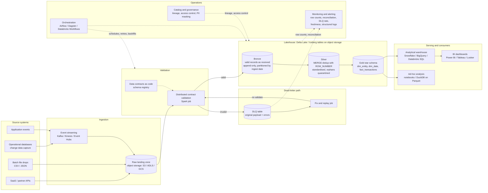

# Proposed Cloud Architecture

> **Proposal only.** Nothing on this page is implemented. The submitted project
> is, and remains, a local Python + Pydantic + DuckDB pipeline (see the README).
> This diagram shows how the same design could be run if data volumes grew to
> terabytes per day. The reasoning behind each choice is in
> [`cloud_scaling.md`](cloud_scaling.md).

The diagram keeps the same steps as the local pipeline: contract validation, a
dead-letter queue, Bronze → Silver → Gold, a star schema, and reconciliation
checks. Only the technology that runs each step changes.

Solid arrows show data flow; dotted arrows show control, metadata, and monitoring.

## How to read the diagram

1. **Sources.** Databases (via change data capture), APIs, events and file
   drops replace the two generated files in `data/raw/`.
2. **Ingestion.** Streams and batch files land unchanged in object storage,
   which replaces the local `data/raw/` folder.
3. **Validation.** The same rules as `src/contracts.py` run as a distributed
   job. They are kept in a schema registry so producers and consumers share
   one versioned contract.
4. **Dead-letter path.** Invalid records go to a DLQ *table* that keeps the
   original payload and errors, as `data/dlq/*.json` does today. After the
   source or the contract is fixed, a replay job sends the records back
   through validation, so nothing is lost or loaded twice.
5. **Lakehouse layers.** Bronze, Silver and Gold become Delta Lake or Iceberg
   tables. Silver uses `MERGE` with the same `ROW_NUMBER()` survivor rule as
   `sql/silver.sql`, so only new or changed records are processed.
6. **Serving.** The Gold star schema is served from a cloud warehouse to BI
   tools and analysts. The queries in `sql/analytics.sql` are standard SQL and
   would need only minor dialect changes.
7. **Operations.** An orchestrator schedules and retries each step and
   backfills history. Monitoring collects the reconciliation results and DLQ
   rates that the local pipeline already produces as log events (for example
   `--log-format json` emits `reconciliation_passed`, `validation_completed`
   with rejected-record counts). A catalog adds lineage, access control and
   masking for personal data such as names and email addresses.

## Local project vs this proposal

| Step | Local project (implemented) | Proposed cloud version (not implemented) |
|---|---|---|
| Raw input | `data/raw/*.csv`, `*.json` | Object storage landing zone, event streams |
| Validation | Pydantic in one Python process | Same contracts, distributed validation job |
| Invalid records | `data/dlq/*.json` | DLQ table with alerts and a replay job |
| Bronze / Silver / Gold | Schemas in one DuckDB file, full refresh | Delta Lake / Iceberg tables, incremental `MERGE` |
| Gold serving | DuckDB file | Cloud analytical warehouse |
| Run control | `python -m src.pipeline` | Orchestrator with schedules, retries, backfills |
| Observability | Logs (text or JSON) and reconciliation checks | Central monitoring, dashboards and alerts |
